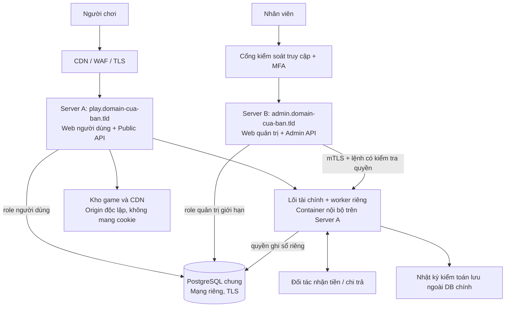

# Kế hoạch cổng game, thi đấu kỹ năng và thanh toán

Ngày lập: 13/11/2026, múi giờ Asia/Bangkok. Trạng thái: kế hoạch triển khai, chưa xây ứng dụng hoặc publish.

Bổ sung theo yêu cầu rà soát quốc tế: [5 thị trường ưu tiên có điều kiện](04-SANG-LOC-QUOC-TE-VA-5-THI-TRUONG-UU-TIEN.md) là Đan Mạch, Thụy Điển, Great Britain, Estonia và Malta. Danh sách sáu nước bên dưới lưu yêu cầu ban đầu; lịch mở tiền thật cần theo kết quả phân loại và các điều kiện mới, không mặc định mở cả hai danh sách.

## 1. Yêu cầu đã xác nhận

- Cổng game tham khảo https://playhop.com/vi, bao phủ trải nghiệm khám phá và chơi game trên trình duyệt.
- Hai server ứng dụng riêng: người dùng và quản trị; hai địa chỉ khác nhau; dùng chung một cơ sở dữ liệu nghiệp vụ.
- Có nạp số dư, mua hàng, chuyển số dư và rút tiền.
- Người chơi nhận tiền từ thi đấu kỹ năng có phí tham gia hoặc mua lượt; không chỉ là xu mua vật phẩm.
- Thị trường mong muốn: Việt Nam, Trung Quốc, Thái Lan, Ấn Độ, Lào, Singapore.
- Chủ dự án cung cấp domain sau. Chưa xác định tên thương hiệu, pháp nhân vận hành, ngân sách, lưu lượng hoặc đối tác nhận/chi tiền.

**Quyết định thiết kế:** xây cổng game và lõi tài chính độc lập về nghiệp vụ; mọi tính năng tiền thật có chính sách theo quốc gia, loại game và đối tác. Không mặc định mở thi đấu trả phí, chuyển tiền hoặc rút tiền ở cả sáu nước. Không thay tên tiền thành điểm/xu để thay đổi phân loại pháp lý.

## 2. Phạm vi tham khảo và độ tin cậy

Đã khảo sát bằng trình duyệt: trang chủ, tìm kiếm, hộp thoại `balance-refill-flow=purchase`, trang KHỐI8, menu và hộp thông tin game. Đã đọc thêm tài liệu công khai của Playhop. Chi tiết ở [ma trận khảo sát](01-KHAO-SAT-TINH-NANG.md).

Không có quyền truy cập admin, mã nguồn, hợp đồng đối tác, giao dịch đã thanh toán hoặc các thử nghiệm A/B của Playhop. Vì vậy đây là kế hoạch bao phủ tính năng công khai cộng các tính năng vận hành cần thiết; không phải xác nhận đã kiểm kê 100% hệ thống nội bộ của họ.

Quyền sở hữu game, hình ảnh và thương hiệu phải do dự án sở hữu/cấp phép hoặc được đối tác cho phép phân phối. Không mặc định tải lại thư viện game của Playhop. Game nhúng bên ngoài thường không cho phép kiểm chứng kết quả hoặc sửa SDK để trả thưởng.

## 3. Kiến trúc hai server

Tên miền sau đây chỉ là ví dụ cấu trúc, chưa được đăng ký hoặc gán DNS.



Đây là **hai server ứng dụng thực sự**, không phải hai đường dẫn trên cùng một tiến trình. Database, object storage và hạ tầng log là dịch vụ dữ liệu dùng chung, không phải server giao diện thứ ba. Lõi tài chính chạy container/process riêng trên A để giữ cấu trúc hai server; chỉ mở endpoint nội bộ cho lệnh quản trị và endpoint webhook tối thiểu qua gateway.

Giới hạn cần nhìn nhận: hai server vẫn chia sẻ database; sự cố DB ảnh hưởng cả hai. Worker nằm trên A vẫn cùng vùng lỗi máy chủ. Khi tăng quy mô có thể tách lõi tài chính sang cụm riêng; đó là thay đổi hạ tầng sau, không âm thầm giả định trong bản hai server.

| Thành phần | Trách nhiệm và giới hạn |
| --- | --- |
| Server A | Catalog, tìm kiếm, tài khoản, phiên chơi, yêu cầu mua/nạp/chuyển/rút, hiển thị lịch sử. Không có khóa DDL hay quyền sửa bảng sổ cái trực tiếp. |
| Server B | Duyệt game, cấu hình, hỗ trợ, tài chính, kiểm soát rủi ro. Không có API sửa tùy ý số dư; không chia sẻ phiên đăng nhập với A. |
| Lõi tài chính | Xử lý lệnh, webhook, sổ cái, khóa tiền, đối soát; tự kiểm tra quyền, chính sách và phê duyệt ở thời điểm thực thi. |
| PostgreSQL | Một primary ghi giao dịch; phân schema và DB role. Không dùng cache hoặc replica trễ để quyết định đủ tiền. |
| Kho game | HTML5/WebGL và media theo phiên bản, origin không cùng miền cookie tài khoản. |
| Worker | Outbox/inbox, thanh toán, phần thưởng, phát vật phẩm, báo cáo; xử lý lặp có kiểm soát. |

Tách tài khoản DB: `player_api`, `admin_api`, `finance_worker`, `report_reader`, `migration_owner`. Chỉ migration pipeline có quyền thay schema. Quyền tạo bút toán được đóng gói ở procedure/API giới hạn, kiểm tra giao dịch cân bằng và chống trùng. Không cấp SUPERUSER cho ứng dụng. Hai server có secret, tài khoản deploy, firewall và chu kỳ cập nhật riêng.

## 4. Nhóm tính năng người dùng

| Nhóm | Phạm vi triển khai |
| --- | --- |
| Khám phá | Trang chủ nhiều hàng game; mới, phổ biến, đề xuất; thể loại, thẻ, độ tuổi, thiết bị; tải thêm; tìm kiếm gợi ý và trạng thái không có kết quả. |
| Trang game | Ảnh/video, mô tả, cách chơi, nhà phát triển, đánh giá, ngôn ngữ, hỗ trợ thiết bị, game tương tự, chia sẻ, báo lỗi. |
| Trình chơi | HTML5/WebGL, toàn màn hình, điều hướng trở về, xử lý load lỗi và mất mạng, hướng màn hình, điều khiển cảm ứng. |
| Tài khoản | Khách chơi game miễn phí; đăng ký/đăng nhập, email/OAuth theo lựa chọn triển khai; hồ sơ, avatar, phiên thiết bị, khôi phục và MFA cho thao tác tài chính. |
| Cá nhân hóa | Gần đây, yêu thích, tiếp tục chơi; lưu tiến trình, thành tích và bảng điểm cho game tích hợp SDK; gợi ý dựa trên hành vi có cơ chế lựa chọn quyền riêng tư. |
| Tương tác | Đánh giá và nhận xét, báo cáo nội dung, thông báo, hộp thư hỗ trợ, FAQ. |
| Thương mại | Gói xu/credit mua nội dung, báo giá số lượng khác nếu bật, mã khuyến mãi, quyền lợi tắt quảng cáo, hóa đơn/biên nhận, lịch sử đơn hàng. |
| Ví | Số dư theo loại và tiền tệ, pending/khả dụng/đang giữ, nạp, chuyển và rút theo chính sách; phí, hạn mức và trạng thái rõ ràng. |
| Thi đấu trả phí | Danh sách giải, luật, điều kiện tham gia, lệ phí, ngân sách thưởng, số chỗ, lịch, kết quả, khiếu nại, hủy/hoàn tiền; chỉ mở tại nơi được phép. |
| Đa quốc gia | Ngôn ngữ và định dạng địa phương; loại tiền độc lập với ngôn ngữ; điều khoản theo thị trường; công tắc theo quốc gia kiểm tra tại backend. |

Đa ngôn ngữ dự kiến: Việt, Anh, Trung giản thể, Thái, Hindi, Lào. Tiếng Hindi không bao phủ toàn bộ Ấn Độ; mở thêm ngôn ngữ theo nhu cầu. Dùng Unicode, bản dịch có người kiểm duyệt và chính sách fallback.

Game miễn phí có thể dùng đối tác nhúng. **Game trả thưởng phải có backend xác minh kết quả**, hợp đồng phân phối và khả năng tích hợp chống gian lận. Không lấy `score` từ JavaScript hoặc sự kiện hoàn thành quảng cáo làm bằng chứng cấp tiền.

## 5. Nhóm tính năng quản trị

| Khu vực | Chức năng |
| --- | --- |
| Tổng quan | Người chơi hoạt động, lượt chơi, tải game lỗi, chuyển đổi nạp tiền, doanh thu, nợ phải trả cho người chơi và đối soát. |
| Danh mục/CMS | Nhập game, metadata, media, thể loại/thẻ, bản dịch, banner, bộ sưu tập, SEO, version, lịch xuất bản và rollback. |
| Kiểm duyệt | Quét build, kiểm tra bản quyền, độ tuổi, quảng cáo, quyền trình duyệt, danh sách origin và báo cáo vi phạm. |
| Người dùng | Tra cứu, tình trạng xác minh, hạn chế tài khoản, lịch sử hỗ trợ; dữ liệu nhạy cảm che theo quyền. |
| Thi đấu | Game/rule version, lịch giải, phí, cấu trúc thưởng, đối soát kết quả, chống thông đồng, hủy giải và giải quyết khiếu nại. |
| Tài chính | Đơn nạp, giao dịch, hoàn tiền, tranh chấp, điều chỉnh có bút toán, yêu cầu chuyển/rút, phê duyệt hai người. |
| Rủi ro | Hàng đợi KYC/risk, bất thường thiết bị, tài khoản liên quan, nhiều tài khoản, tốc độ giao dịch, tài khoản nhận tiền. |
| Vận hành | Webhook lỗi, job lỗi và replay có chống trùng, đối soát, cảnh báo, trạng thái đối tác, tạm dừng loại giao dịch. |
| Phân quyền | Vai trò theo nhiệm vụ, lịch sử cấp quyền, MFA, đăng nhập nhân viên riêng, audit truy cập và xuất dữ liệu. |
| Đối tác | Hồ sơ nhà phát triển, gửi game/SDK, kiểm duyệt, chia sẻ doanh thu và báo cáo; payout nhà phát triển tách nghiệp vụ thưởng người chơi. |

Vai trò khởi đầu: Content Editor, Moderator, Support, Finance Maker, Finance Approver, Risk Analyst, Auditor, Platform Administrator. Quản trị hạ tầng không mặc nhiên được phê duyệt tiền. Người lập yêu cầu không được tự duyệt yêu cầu của mình; UI ẩn nút không thay thế kiểm tra ở API.

## 6. Thi đấu kỹ năng: phải thiết kế như một hệ thống riêng

1. Công bố luật: kỹ năng đo gì, phí tổng, cách ghép trận, thiết bị được hỗ trợ, tie-break, mất kết nối, hành vi bị cấm, thời hạn khiếu nại và điều kiện hủy.
2. Mỗi giải gắn một phiên bản game và luật bất biến sau khi có người tham gia. Thay đổi quan trọng phải hủy/hoàn theo chính sách, không sửa âm thầm.
3. Đặt chỗ có TTL; kiểm tra tuổi/quốc gia/xác minh/hạn mức; giữ phí trong transaction. Không thu quá số chỗ khi nhiều người vào đồng thời.
4. Khi trận đủ điều kiện bắt đầu mới chuyển phí từ held sang tài khoản giải. Hủy trước khi bắt đầu thì giải phóng/hoàn đúng một lần.
5. Kết quả do game server ký, gắn người chơi, trận, challenge, build và chống replay. Server kiểm tra tính hợp lệ, thời gian và bằng chứng; với game phù hợp có replay quyết định hoặc mô phỏng lại.
6. Chống bot, sửa bộ nhớ, tăng tốc, nhiều tài khoản, thông đồng, dàn xếp kết quả và mua bán tài khoản. Game không xác minh được kết quả chỉ được chơi miễn phí.
7. Kết quả tạm thời → kiểm tra → thời gian khiếu nại → kết quả cuối → ghi thưởng pending → khả dụng theo chính sách. Trạng thái và thời hạn công khai.
8. Prize pool và nghĩa vụ thưởng phải có nguồn bảo đảm xác định trước; tách phí nền tảng, thuế/khấu trừ, khoản phải trả và chi phí đối tác.
9. Không thay đổi kết quả để điều chỉnh tỷ lệ thắng/thua hoặc khả năng chi trả. Tranh chấp và sửa sai có bằng chứng, phê duyệt và bút toán đảo.

Không thể đưa mọi game trong catalog vào giải tiền thật. Mỗi game cần đánh giá khả năng chống gian lận, công bằng giữa thiết bị, độ trễ và kiểm chứng server trước khi duyệt.

## 7. Dữ liệu dùng chung

| Schema | Bảng/nhóm chính |
| --- | --- |
| identity | users, identities, user_sessions, admin_principals, admin_sessions, roles, grants, verification_refs, policy_acceptances |
| catalog | games, game_versions, developers, categories, tags, translations, assets, releases, moderation_cases |
| engagement | play_sessions, saves, favorites, achievements, ratings, reviews, leaderboard_entries, notifications |
| commerce | products, price_versions, quotes, orders, order_items, payment_attempts, entitlements, delivery_jobs, refunds, disputes |
| finance | accounts, journal_transactions, journal_lines, holds, balance_projections, transfers, payouts, payout_attempts, fund_lots, fund_allocations, fx_quotes |
| competitions | tournaments, rules_versions, entries, matches, result_evidence, adjudications, prize_allocations, reward_claims |
| operations | provider_events, idempotency_keys, outbox, jobs, reconciliation_runs, reconciliation_items, approval_requests, audit_events, country_policies |

Sổ cái là nguồn chuẩn. Các cột balance để tăng tốc phải cập nhật cùng transaction với journal và có thể dựng lại. DB migrations dùng một pipeline chung với cơ chế expand/contract để hai server có thể deploy độc lập. Không chia sẻ một tài khoản DB có toàn quyền.

## 8. Công nghệ và triển khai

Định hướng: TypeScript cho hai ứng dụng và API; Next.js cho web có SEO và khả năng self-host; PostgreSQL cho giao dịch; object storage/CDN cho game; hàng đợi bền vững + worker cho xử lý nền. Cache/rate limiter không giữ nguồn số dư. Chốt framework backend, queue và phiên bản khi lập ADR triển khai; không chọn nhiều framework chỉ để chia nhỏ hệ thống.

Next.js có tài liệu self-host và khuyến nghị reverse proxy phía trước ứng dụng: [tài liệu chính thức](https://nextjs.org/docs/app/guides/self-hosting). PostgreSQL có cơ chế transaction isolation phù hợp thiết kế giao dịch đồng thời, nhưng ứng dụng vẫn phải thiết kế khóa, constraint và retry: [tài liệu chính thức](https://www.postgresql.org/docs/current/transaction-iso.html).

Cấu trúc repository dự kiến:

```text
apps/player-web/       # Build và deploy A
apps/admin-web/        # Build và deploy B
services/finance/      # Container nội bộ, ban đầu đặt trên A
workers/               # Inbox/outbox, đối soát, phát vật phẩm
packages/contracts/    # API schemas, kiểu dữ liệu; không chứa secret
packages/game-sdk/     # SDK phiên chơi, save, ads, purchase, result integration
database/migrations/   # Schema chung, grants và procedure
infra/                 # Hai deploy targets, mạng riêng, backup, observability
docs/                  # Đặc tả và runbook
```

Môi trường local, staging, production có DB và secret riêng. Shared database chỉ nghĩa là A/B trong cùng môi trường dùng chung DB. Không dùng production để thử thanh toán sandbox.

Domain do chủ dự án cung cấp sẽ gán vào A/B; bản publish ban đầu có thể dùng địa chỉ staging. Cấu hình DNS theo đích hosting thực tế, HTTPS, cookie host-only, OAuth callback, payment return/webhook, email và CSP. Không hứa loại bản ghi hoặc IP trước khi chốt hosting. Nếu dùng domain gốc/subdomain thì có thể dùng `play.*` và `admin.*`; hai domain độc lập cũng được.

Trung Quốc đại lục cần đánh giá riêng đối tác, khả năng truy cập hạ tầng, yêu cầu dữ liệu và việc phát hành game. Không giả định một deployment toàn cầu và một CDN sẽ đáp ứng mọi thị trường. Giữ thiết kế DB chung trong giai đoạn này; nếu yêu cầu lưu trữ nội địa xung đột, phải sửa kiến trúc trước khi mở thị trường đó.

## 9. Lộ trình theo mốc nghiệm thu

Ước lượng dưới đây là sơ bộ cho nhóm có khoảng 4–6 kỹ sư cùng QA, thiết kế và hỗ trợ bảo mật; không phải cam kết tiến độ. Không bao gồm thời gian xin phép, hợp đồng thanh toán, phát triển toàn bộ game hoặc tích hợp hàng nghìn game.

| Mốc | Thời lượng dự kiến | Kết quả / tiêu chí chuyển mốc |
| --- | --- | --- |
| M0: xác định mô hình | 1–3 tuần kỹ thuật/sản phẩm; thẩm định bên ngoài có thể lâu hơn | Luật thi đấu, dòng tiền, pháp nhân, các nước được phép, quyền game, ADR hai server; chưa bật tiền thật. |
| M1: nền tảng | 2–3 tuần | A/B chạy độc lập, CI/CD, DB role, tài khoản, catalog, CMS, quan sát lỗi, staging. |
| M2: cổng game | 3–5 tuần | Khám phá/tìm kiếm/player, mobile, game SDK mẫu, lịch sử/yêu thích, tiến trình, review, hỗ trợ và đa ngôn ngữ nền. |
| M3: lõi tiền | 4–6 tuần | Sổ cái, quote, purchase/nạp sandbox, webhook, hoàn/chargeback, đối soát, phân quyền và thử lỗi đồng thời. |
| M4: thi đấu | 4–8 tuần cho game đầu tiên | Một game có kết quả kiểm chứng server, giải, giữ phí, hủy/hoàn, khiếu nại, ghi thưởng và chống gian lận. |
| M5: chuyển/rút | 3–5 tuần | KYC, recipient, duyệt, payout sandbox, timeout, đối soát ngân hàng/đối tác, kiểm thử end-to-end. |
| M6: mở giới hạn | 2–4 tuần | Pentest, diễn tập restore và sự cố chi trả, giới hạn người dùng/tiền, chỉ thị trường đã được duyệt. |
| M7: mở rộng | Theo dữ liệu vận hành | Cổng nhà phát triển tự phục vụ, gợi ý nâng cao, nhiều game/đối tác/thị trường, quảng cáo và affiliate. |

Một số việc song song được sau M1; dự kiến khoảng **5–8 tháng cho bản có một game thi đấu trả thưởng đủ điều kiện kỹ thuật**, tùy đội ngũ và độ khó game. Mở tiền thật chỉ sau khi đáp ứng điều kiện từng thị trường. Tương đương toàn bộ hệ sinh thái/catalog Playhop là chương trình phát triển liên tục, không phải một lần dựng giao diện.

## 10. Nghiệm thu và vận hành

- Luồng chính: tìm game → chơi → đăng nhập → lưu tiến trình → mua nội dung; giải trả phí và tài chính có bộ nghiệm thu riêng.
- Desktop/mobile, bàn phím, focus modal, nhãn trợ năng, bản dịch dài, đường truyền yếu và thiếu WebGL phải có trạng thái phù hợp.
- Mục tiêu ban đầu để benchmark: LCP p75 dưới 2,5 giây cho catalog trên thiết bị/mạng đã thống nhất; thời gian tải từng game báo riêng; 500 người chơi đồng thời và 50 lệnh tài chính/giây trong môi trường tải thử. Đây là mục tiêu kiểm thử, chưa phải kết quả hoặc cấu hình máy đã được chứng minh.
- Giám sát p95 API, lỗi load game, queue lag, webhook lỗi, payout UNKNOWN, nợ người chơi, tiền backing và chênh lệch đối soát.
- Backup mã hóa, PITR, restore drill; mục tiêu DB RPO ≤ 5 phút, RTO ≤ 60 phút cần đo và ngân sách. Sau restore phải tạm dừng chi trả, đối soát lại các giao dịch đã xảy ra ngoài hệ thống trước khi mở, tránh chi hai lần.
- Không gọi hệ thống là an toàn tuyệt đối. Tiền thật cần review threat model, kiểm toán code tài chính và pentest độc lập; các lỗi nghiêm trọng phải xử lý trước khi mở.
- Chi phí phải tách: phát triển platform, quyền/tạo game, máy chủ/CDN/DB/log, phí nhận/chi tiền/FX, KYC/risk, pháp lý/giấy phép, tiền bảo đảm thưởng và hỗ trợ vận hành. Chưa đủ dữ liệu để báo giá đáng tin cậy.

## 11. Điều kiện chốt trước khi triển khai tiền thật

1. Pháp nhân/quốc gia vận hành; kết luận chuyên môn theo từng nước về chính xác game và mô hình thu phí trả thưởng.
2. Chọn game thi đấu đầu tiên, quyền sở hữu/tích hợp, luật và cách xác minh kết quả; không chỉ chọn ảnh game từ catalog.
3. Phí tham gia/mua lượt, tổng thưởng, nguồn đảm bảo, phí nền tảng, khiếu nại, hoàn tiền, thuế và hủy giải.
4. Đối tác chấp nhận rõ mô hình nhận tiền, chuyển người dùng và chi tiền thưởng; phạm vi từng nước/loại tiền. Merchant thanh toán game thông thường không tự cho phép ví/chuyển/rút.
5. Chính sách chuyển số dư nào: tiền thưởng đã quyết toán, credit mua nội dung hay cả tiền nạp. Mặc định thiết kế an toàn chỉ cho phép loại được phê duyệt, không gộp tất cả.
6. Số lượng game và tải mục tiêu, ngân sách, nhân sự, tên miền người dùng/admin, branding và nội dung.

Các mục này được để thành quyết định sản phẩm/triển khai; không cản trở việc làm catalog, thiết kế UI, DB và luồng sandbox. Xem [đặc tả tài chính](02-THANH-TOAN-VA-SO-CAI.md) và [ma trận thị trường](03-THI-TRUONG-VA-DIEU-KIEN-MO.md).
