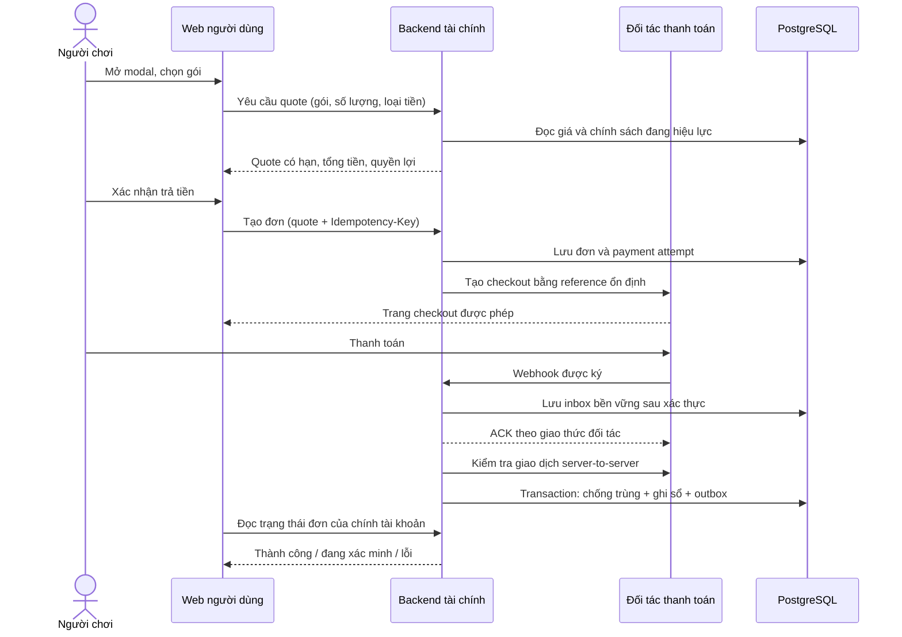

# Đặc tả nạp, mua, phí thi đấu, chuyển và rút tiền

Ngày: 13/11/2026. Đây là thiết kế đề xuất cho dự án, không phải mô tả backend của Playhop. Phạm vi đã chốt: thi đấu kỹ năng có phí tham gia/mua lượt, tiền thưởng có thể rút, nhiều quốc gia. Khả năng mở tiền thật theo từng nước nằm trong [ma trận thị trường](03-THI-TRUONG-VA-DIEU-KIEN-MO.md).

## 1. Các bất biến bắt buộc

1. Mỗi giao dịch sổ cái cân bằng theo từng đơn vị/loại tiền và pháp nhân. Không cân USD bằng VND hoặc điểm game bằng tiền thật.
2. Không dùng số thực nhị phân cho tiền: `BIGINT` đơn vị nhỏ nhất theo cấu hình ISO/provider; rate dùng decimal chính xác. VND, INR, THB, CNY, LAK, SGD không được giả định có cùng số chữ số thập phân. Quy tắc làm tròn được version hóa.
3. Một nghiệp vụ chỉ gây hiệu ứng tài chính một lần dù API, webhook hoặc job chạy nhiều lần. Không tuyên bố mạng truyền đúng một lần.
4. Không trừ quá số khả dụng. Giữ tiền, ghi sổ và cập nhật trạng thái liên quan phải nằm trong transaction nguyên tử.
5. Nguồn giá, ưu đãi, phí, quyền lợi và người nhận là backend. Client không có quyền gửi số dư sau giao dịch hay giá tự chọn.
6. Sổ đã ghi không sửa/xóa; điều chỉnh bằng bút toán đảo/bổ sung có tham chiếu và chứng cứ.
7. Tài khoản người chơi, tiền nhà vận hành, doanh thu và tiền bảo đảm giải được phân biệt. Số dư trên màn hình không chứng minh đã có tiền backing tại ngân hàng/đối tác.
8. Không trao tiền thật dựa trên localStorage, score client, URL, email biên nhận, ảnh chuyển khoản hoặc nhân viên đánh dấu “đã thanh toán”.

Các hướng dẫn tích hợp cổng thanh toán nhấn mạnh tính lại giá ở server, xác thực callback và kiểm tra giao dịch trước khi giao hàng: [OWASP Payment Gateway Integration](https://cheatsheetseries.owasp.org/cheatsheets/Third_Party_Payment_Gateway_Integration_Cheat_Sheet.html). Thiết kế bên dưới bổ sung chi tiết nghiệp vụ riêng cho hệ thống này.

## 2. Mô hình số dư và nguồn tiền

| Loại | Sử dụng | Khả năng chuyển/rút |
| --- | --- | --- |
| GAME_POINTS | Điểm chơi, thành tích | Không quy đổi tự động thành tiền; không trộn với cash ledger. |
| PURCHASE_CREDITS | Credit/xu mua vật phẩm | Chính sách riêng; mặc định không chuyển/rút, việc hoàn tiền đi về nguồn gốc theo quy định. |
| CASH_DEPOSIT | Tiền nạp dành cho dịch vụ được phép | Có theo dõi nguồn và thời gian quyết toán; chi/chuyển/rút chỉ nếu mô hình và đối tác cho phép. |
| CASH_WINNINGS | Nghĩa vụ thưởng tiền từ giải đã quyết toán hợp lệ | Pending → được kiểm tra → khả dụng; có thể chuyển/rút tại nơi đã mở. |
| BONUS | Khuyến mãi | Hạn dùng và điều kiện minh bạch; mặc định không rút/chuyển; không dùng vòng quay hay điều kiện cược để biến thành tiền. |

Mỗi tài khoản tiền thật gắn `user_id`, `legal_entity_id`, `currency`, `fund_type`. Trong từng loại có trạng thái pending/available/held/restricted. Giao diện hiển thị riêng **được dùng**, **được rút**, **đang giữ**, **chờ quyết toán**; giải thích chênh lệch.

Mỗi khoản tiền có provenance: nguồn nạp/giải, provider transaction, ngày, trạng thái thanh toán, hạn chế, người sở hữu và allocations đã dùng. Chuyển người dùng không làm sạch nguồn tiền hoặc bỏ thời gian giữ. Chống vòng chuyển A→B→C→A và chia nhỏ giao dịch phải xét đồ thị tài khoản/recipient theo chính sách và quyền riêng tư.

Một đồng tiền hiển thị không nhất thiết là loại tiền có thể chi trả tại nước đó. Không mặc định hỗ trợ FX chéo giữa người dùng. Bản đầu chuyển cùng tiền tệ và trong phạm vi pháp nhân/country corridor đã được phê duyệt; chuyển quốc tế/FX là chức năng riêng.

## 3. Luồng giao diện nạp `balance-refill-flow=purchase`

Tham số URL chỉ chọn trạng thái UI. Mở link không tạo đơn, không tự bắt đầu thanh toán, không thay người nhận, không cộng tiền. Đóng modal/Back hoạt động và không mất giao dịch đang chờ.

Modal cần có số dư đúng loại, gói, số tiền thực trả, phí/thuế nếu có, quyền lợi chính xác, tiền tệ, email biên nhận, hạn quote và liên kết chính sách. Có loading, mất mạng, quote hết hạn/giá đổi, sai số lượng, chưa đăng nhập, chưa xác minh, hạn mức, không hỗ trợ quốc gia/phương thức. Bản dự án yêu cầu tài khoản hợp lệ trước khi tạo checkout gắn số dư.

`quote` gắn người dùng, SKU, price version, số lượng, tiền tệ, pháp nhân, phí/thuế, ưu đãi, số tiền thu, số đơn vị cấp, loại số dư và TTL. Đổi bất kỳ dữ liệu quan trọng nào phải báo giá lại và cho người chơi xác nhận. Số lượng tùy chọn có min/max/step và hạn mức server; không lấy dải số của Playhop làm quy định sản phẩm.

Checkout do backend tạo, chuyển tới domain đối tác được allowlist. Return URL cố định theo môi trường; không dùng redirect tùy ý từ query. Email biên nhận không xác định chủ ví. Token checkout ngắn hạn, giới hạn quyền; không lưu token trong analytics hoặc log.

## 4. Webhook, xác nhận và giao dịch trễ

- Xác minh chữ ký trên **raw body**, đúng thuật toán/tài khoản/secret của provider; không tự thay thuật toán. So sánh an toàn; kiểm tra timestamp nếu giao thức có hỗ trợ. IP allowlist chỉ là lớp bổ sung.
- Match merchant/project, môi trường sandbox/live, external order ID, provider transaction ID, người dùng, số tiền phải thu, tiền tệ và SKU/quyền lợi dự kiến. Nếu provider tách gross/net/thuế/phí thì match trường đúng ngữ nghĩa, không so net settlement với gross charge.
- Đọc trạng thái canonical từ API đối tác trước fulfillment theo adapter đã thiết kế. Nếu API không có cho luồng cụ thể, cần review giao thức bằng chứng đã ký và điều kiện của đối tác; không tự bỏ bước kiểm chứng.
- Webhook hợp lệ được lưu inbox/queue bền vững trước ACK. Không ACK thành công khi chỉ đưa vào bộ nhớ. Nếu DB/queue lỗi thì trả mã tạm thời đúng giao thức để provider retry.
- ACK nhanh sau khi lưu; worker thực thi nghiệp vụ riêng. Retry không làm cộng hai lần. Payload phục vụ điều tra chỉ lưu trường cần thiết hoặc bản mã hóa có thời hạn, không log nguyên body chứa PII/secret.
- Event ID dedupe và provider transaction ID dedupe là hai lớp khác nhau: hai event ID khác nhau vẫn có thể cùng một lần thu tiền.
- Một đơn có nhiều payment attempt thì phải phân biệt lần thanh toán thực. Nếu hai lần thu thật thành công, chỉ cấp quyền lợi theo quy tắc đơn; lần thu dư đưa vào xử lý hoàn/đối soát, không âm thầm mất hoặc nhân đôi vật phẩm.
- Event đến trễ, đảo thứ tự, trả tiền sau khi checkout hết hạn vẫn phải được xác minh. Không tự bỏ tiền đã thu vì UI hết TTL. Nếu giải đã bắt đầu/đầy thì hoàn tiền hoặc đưa exception theo chính sách, không thêm người chơi muộn.
- Browser return, query `status=success`, callback trong iframe và email chỉ là tín hiệu UI. Màn hình ghi “đang xác minh” cho đến khi backend xác nhận.

Nếu chọn XSolla, tài liệu của họ yêu cầu xác minh raw body, hỗ trợ gửi lại và idempotency; lịch retry khác nhau theo loại webhook nên adapter phải theo API đã chọn, không hard-code một lịch cho mọi loại. [XSolla webhook reference](https://developers.xsolla.com/webhooks), [payment webhook](https://developers.xsolla.com/webhooks/payments).

## 5. Trạng thái riêng cho từng lớp

| Đối tượng | Trạng thái chính và quy tắc |
| --- | --- |
| Quote | ACTIVE → USED / EXPIRED; chỉ dùng theo đúng chủ sở hữu và nội dung. |
| Payment attempt | CREATED → PENDING → SUCCEEDED / FAILED / UNKNOWN; timeout không đồng nghĩa FAILED. |
| Order | CREATED → AWAITING_PAYMENT → PAID → FULFILLING → FULFILLED; CANCELLED/EXPIRED là checkout lifecycle, không phủ nhận sự kiện thu tiền xác thực đến muộn. |
| Refund | REQUESTED → APPROVED → SUBMITTED → SUCCEEDED / FAILED / UNKNOWN; tổng hoàn không vượt phần được hoàn. |
| Transfer | REQUESTED → HELD/REVIEW → POSTED / REJECTED / CANCELLED; cùng DB thì chuyển hai đầu nguyên tử. |
| Entry | RESERVED → ELIGIBLE → CONFIRMED → PLAYING → COMPLETED; EXPIRED/CANCELLED và hoàn phí gắn reason. |
| Prize | PROVISIONAL → REVIEW → FINALIZED → PENDING_RELEASE → AVAILABLE; bác bỏ/đảo có audit. |
| Payout | REQUESTED → FUNDS_HELD → REVIEW → APPROVED → SUBMITTED → PROCESSING → SUCCEEDED / FAILED; UNKNOWN và RETURNED là nhánh riêng cần đối soát. |

Settlement của provider, chi trả và việc ghi credit là các lớp khác nhau. Thu tiền thành công không mặc định tiền đã rút được ngay. Không cho event FAILED đến trễ ghi đè giao dịch SUCCEEDED, hoặc cho yêu cầu hủy của client giải phóng payout đã SUBMITTED.

## 6. Sổ cái kép và tính đồng thời

Ví dụ minh họa 100 đơn vị của **cùng một tiền tệ**, chưa gồm phí/thuế; mapping tài khoản chính thức phải do kế toán xác nhận:

| Nghiệp vụ | Nợ (Debit) | Có (Credit) |
| --- | --- | --- |
| Provider xác nhận thu nạp | Khoản phải thu từ PSP 100 | Nợ phải trả số dư pending người chơi 100 |
| PSP quyết toán | Tiền tại đối tác/ngân hàng + phí thực tế | Khoản phải thu PSP tương ứng |
| Cho phép dùng tiền | Nợ phải trả pending 100 | Nợ phải trả available 100 |
| Giữ phí giải | Nợ phải trả available 100 | Nợ phải trả held người chơi 100 |
| Chuyển phí khi xác nhận entry | Nợ phải trả held | Tài khoản thanh toán giải/phí nền tảng theo cấu trúc đã duyệt |
| Trả thưởng | Tài khoản giải/nguồn thưởng | Nợ phải trả winnings pending của người thắng |
| Chuyển A sang B | Nợ phải trả available A 100 | Nợ phải trả available B 100 |
| Giữ để rút | Nợ phải trả available 100 | Nợ phải trả payout-held 100 |
| Payout thành công | Nợ phải trả payout-held 100 | Tài sản tiền tại provider/ngân hàng 100 |

Tài khoản người chơi là liability trong sổ của nhà vận hành, vì vậy debit liability làm giảm nghĩa vụ với người chơi. Không suy ra dấu `+/-` chỉ từ tên giao dịch; dùng posting template kiểm duyệt. Bonus/điểm được hạch toán theo đơn vị riêng, không giả thành tiền backing.

Trong transaction ghi sổ: kiểm tra idempotency và trạng thái → lock account/hold theo thứ tự ổn định → kiểm tra đủ available và hạn mức → tạo journal cân bằng → cập nhật projection/hold và nguồn tiền → lưu outbox → commit. Dùng row lock hoặc SERIALIZABLE theo thiết kế, constraint unique và retry có giới hạn cho deadlock/serialization failure. Không gọi API ngoài trong khi giữ DB lock.

DB procedure phải kiểm tra tổng debit/credit của toàn transaction theo currency/entity trước commit; constraint từng dòng không đủ bảo đảm cân bằng nhiều dòng. App role không có quyền ghi trực tiếp journal. Nếu dùng SECURITY DEFINER phải khóa `search_path`, schema qualify tên bảng và loại bỏ khả năng gọi SQL tùy ý. PostgreSQL isolation là công cụ, không tự giải quyết double-spend: [tài liệu](https://www.postgresql.org/docs/current/transaction-iso.html).

## 7. Mua vật phẩm và phí tham gia

Mua bằng số dư: backend lấy giá SKU → kiểm tra quyền người chơi/game → giữ/trừ tiền và tạo entitlement/job trong cùng transaction → phát vật phẩm idempotent qua outbox. Game chỉ nhận receipt có phạm vi game/người dùng/đơn; không tự tăng số dư từ client. Mất kết nối sau khi trả tiền phải truy vấn lại receipt, không yêu cầu mua lần nữa.

Với game của đối tác, nếu phát vật phẩm ngoài DB thất bại, giữ trạng thái DELIVERY_PENDING và retry; hết thời hạn thì quy trình hoàn có kiểm soát. Không vừa cấp vật phẩm muộn vừa hoàn đơn do hai worker chạy chồng.

Giữ phí entry phải đồng thời với giữ chỗ/định danh entry. Unique `(tournament_id, user_id, entry_index)` theo số lượt được phép. Giới hạn số lần, chỉ cho giải được duyệt ở quốc gia đó. Dự trữ thưởng tối đa và phiên bản luật trước khi thu phí đầu tiên.

Kết quả trả thưởng dùng unique `(tournament_id, prize_allocation_id, beneficiary)`; kiểm tra finalization version và bằng chứng. API game chỉ gửi claim/evidence, không gửi lệnh “cộng X tiền”. Số tiền thưởng tính từ luật đã khóa. Chặn thanh toán khi hết ngân sách hoặc dữ liệu kết quả mâu thuẫn.

## 8. Chuyển tiền người dùng

Chỉ cho loại số dư được phép theo chính sách, không mặc định chuyển purchase credits/bonus. Kiểm tra sender, recipient đã xác thực, cùng currency/corridor, hạn mức, restriction và nguồn tiền. Xác nhận tên người nhận đã che bớt và số tiền/phí trước thao tác; không tiết lộ email/điện thoại để dò tài khoản.

Challenge xác nhận gắn người gửi, người nhận, số tiền, currency, phí và thời hạn; đổi dữ liệu phải xác nhận lại. Xử lý chống replay, xác thực bổ sung khi rủi ro cao, ngăn phiên tài khoản bị chiếm. [OWASP Transaction Authorization](https://cheatsheetseries.owasp.org/cheatsheets/Transaction_Authorization_Cheat_Sheet.html) là tham chiếu cho việc kiểm tra và ràng buộc giao dịch tại server.

Chuyển trong DB: hai phía ghi trong cùng transaction, bảo toàn nguồn/hạn chế. Sau POSTED không cung cấp nút hủy tùy ý; khiếu nại đi vào case và bút toán điều chỉnh theo quyết định hợp lệ. Chuyển xuyên tiền tệ/pháp nhân/quốc gia không coi là chuyển nội bộ thông thường.

## 9. Rút tiền

1. Kiểm tra khả năng mở tính năng theo quốc gia và game; tài khoản, tuổi, KYC, screening và trạng thái rủi ro. Ngưỡng/biện pháp KYC/AML cụ thể do chính sách thị trường và đối tác quyết định.
2. Recipient lưu bằng token/reference từ provider; xác minh chủ nhận và phương thức được phép. Đổi recipient có MFA, thông báo và thời gian chờ theo rủi ro. Không giữ toàn bộ dữ liệu ngân hàng nếu không cần.
3. Cho người chơi xem số rút, phí, FX nếu có, thực nhận, thời gian dự kiến và hạn mức trước khi xác nhận.
4. Lock và giữ đủ tiền + phí; tạo payout request và outbox nguyên tử. Hai yêu cầu song song không giữ vượt available.
5. Rà soát theo risk/threshold; yêu cầu manual có người lập và người duyệt khác nhau. Quyết định gắn hash nội dung và TTL, thay recipient/số tiền làm phê duyệt mất hiệu lực.
6. Worker gửi payout với idempotency key cố định theo request. Provider timeout → UNKNOWN; giữ tiền và tra cứu bằng reference. **Không tự giải phóng tiền hoặc gửi lại bằng ID mới.**
7. Chỉ ghi hoàn tất khi bằng chứng server-to-server được xác minh. Definitive failure mới trả held về available; payout returned sau thành công là sự kiện riêng, hoàn lại sau khi xác nhận tiền thực sự quay về.
8. Nếu provider không có idempotency/tra cứu đáng tin cậy, tạm giữ và xử lý exception có kiểm soát; không bật tự động hóa mù cho chi trả.
9. Sau chi trả vẫn đối soát payout, tài sản tại provider/ngân hàng, phí và FX. Hệ thống không cấp thêm tiền chỉ vì webhook SUCCEEDED bị gửi lại.

Khoản tiền từ nạp thẻ có thể bị chargeback sau đó; settlement không loại bỏ hoàn toàn rủi ro. Nguồn tiền chuyển và tiền thưởng phải giữ được bằng chứng liên hệ; có dự phòng, thời gian giữ và xử lý số dư thiếu. Không tự tạo số dư âm có thể chi; thiếu hụt ghi receivable/risk case, chặn chi theo quyền hợp lệ.

## 10. API dự kiến và idempotency

| API | Quy tắc |
| --- | --- |
| `GET /api/v1/wallets` | Chỉ ví của principal; trả currency/fund_type và các trạng thái số dư. |
| `POST /api/v1/quotes` | Báo giá server, không nhận giá từ client làm chuẩn. |
| `POST /api/v1/topups` | Quote hợp lệ + Idempotency-Key; trả checkout URL allowlist. |
| `GET /api/v1/orders/:id` | Kiểm tra ownership ở backend, không chỉ UUID khó đoán. |
| `POST /api/v1/purchases` | Mua SKU bằng số dư; trả receipt/trạng thái delivery. |
| `POST /api/v1/tournaments/:id/entries` | Giữ chỗ và phí nguyên tử; policy theo quốc gia và game. |
| `POST /api/v1/transfers` | Ràng buộc challenge và recipient, policy và nguồn tiền. |
| `POST /api/v1/payouts` | Giữ tiền, kiểm tra KYC/recipient/policy, không gửi provider trực tiếp từ UI. |
| `POST /webhooks/:provider` | Ngoại lệ CSRF cho webhook, thay bằng xác thực provider; giới hạn body/rate theo hợp đồng. |
| `POST /internal/admin/approvals/:id/decisions` | Chỉ mạng nội bộ + mTLS; backend tự xác thực actor/quyền, không tin header do client đặt. |

Idempotency record gắn actor + operation + key, kèm hash payload và kết quả. Key trùng payload khác → conflict; cùng payload trả kết quả cũ. Lưu đủ lâu theo retry và nghĩa vụ tài chính; unique business reference tồn tại lâu dài dù API cache idempotency hết hạn. Unique provider transaction theo provider+merchant+environment, không chỉ một ID toàn hệ thống.

Không thực thi side effect bằng GET. CSRF token/Origin validation cho cookie API; CORS allowlist chính xác; cookie `Secure`, `HttpOnly`, host-only, tên có tiền tố `__Host-` khi phù hợp. Vì subdomain có thể cùng site, SameSite không thay thế CSRF. User token không được admin API chấp nhận và ngược lại.

## 11. Hoàn tiền, tranh chấp và đối soát

- Refund payment khác payout winnings. Hoàn về nguồn gốc qua provider theo chính sách; không dùng chức năng rút để né refund.
- Refund toàn phần/một phần và chargeback có ID riêng, theo dõi phần đã hoàn, revoke entitlement/bonus theo luật đã công bố. Không trừ lần nữa khi refund và chargeback cùng liên quan một payment.
- Tiền đã tham gia giải/trả thưởng/chuyển tiếp cần exception, truy vết và dự phòng; không âm thầm xóa thưởng hợp lệ của người khác để làm cân số.
- Đối soát ít nhất hằng ngày và liên tục cho lệnh UNKNOWN: đơn ↔ payment/provider ↔ journal ↔ settlement/ngân hàng. Prize liabilities, phí, thuế, FX và payout có báo cáo riêng.
- Lệch đối soát tạo case và ngưỡng cảnh báo; có thể pause tự động loại giao dịch liên quan. Sửa bằng bút toán có evidence, không UPDATE balance để khớp báo cáo.
- Replay chỉ từ dữ liệu đã xác thực, có RBAC/MFA, reason và audit; vẫn đi qua logic idempotent, không bypass constraint.

## 12. Bảo vệ hệ thống và game

Admin có MFA bắt buộc, phiên ngắn và xác thực lại cho thao tác tiền; tách vai trò, mTLS nội bộ, secret manager và khóa sandbox/live riêng. Audit ghi actor, nội dung, reason, phiên bản, approvals và correlation ID; xuất bản sao vào kho append-only/WORM ngoài DB ứng dụng. Không gọi log trong DB là bất biến tuyệt đối khi chủ DB có quyền thay đổi.

Game ở origin tách biệt cookie, iframe sandbox với quyền tối thiểu. `postMessage` kiểm tra exact origin, source, schema, game/session/nonce và action allowlist; không `targetOrigin=*` cho dữ liệu nhạy cảm. Game không được cầm session admin, secret provider hoặc quyền chi tiền. CSP cho UI và frame, kiểm soát upload ZIP path traversal/zip bomb, quét mã độc, version build và quyền game.

Tài liệu KYC ưu tiên hosted flow/provider vault; DB lưu reference và trạng thái tối thiểu. Mã hóa, phân quyền, thời hạn lưu và xóa theo thị trường; hạn chế xuất dữ liệu. Không lưu PAN/CVV/PIN và OTP vào DB/log. Hosted checkout giảm phạm vi xử lý thẻ nhưng không tự miễn nghĩa vụ bảo mật/đánh giá phù hợp.

## 13. Bộ nghiệm thu tài chính tối thiểu

| Ca kiểm thử | Kết quả bắt buộc |
| --- | --- |
| Sửa URL/giá/SKU/người dùng ở client | Không cộng tiền hoặc mua sai giá. |
| Webhook sai signature hoặc sai merchant/live mode | Từ chối, không ghi hiệu ứng tài chính. |
| Webhook hợp lệ nhưng sai amount/currency/order | Exception, không cấp quyền lợi. |
| Gửi lại 100 webhook, kể cả event ID khác | Một lần credit cho một lần thu; vẫn ghi nhận delivery phục vụ audit. |
| Hai payment attempt cùng thu tiền | Không cấp vật phẩm hai lần ngoài ý muốn; tiền dư được xử lý rõ. |
| Hai lệnh mua/chuyển/rút chi hết cùng available | Không double-spend, journal cân bằng. |
| Cùng key, payload khác | Conflict, không tạo thêm giao dịch. |
| Provider thành công rồi process chết trước update | Tra cứu/retry cùng reference khôi phục đúng một hiệu ứng. |
| DB lỗi sau nhận webhook | Không ACK mất sự kiện; retry khôi phục được. |
| Payout timeout nhưng ngân hàng đã trả | UNKNOWN được đối soát, không release hoặc trả lần hai. |
| Hủy entry đúng lúc giải bắt đầu, chỗ cuối tranh chấp | Một quyết định nguyên tử, không quá slot/thu phí sai. |
| Điểm client giả, replay kết quả, sai game build | Không cấp thưởng tiền. |
| Kết quả sửa sau finalized/giải khiếu nại | Có case, phiên bản và bút toán đảo; không ghi thưởng lặp. |
| Phê duyệt bởi maker hoặc đổi recipient sau duyệt | Bị chặn ở backend. |
| Refund một phần và chargeback đến đảo thứ tự | Không hoàn/trừ trùng; báo cáo truy vết. |
| Country flag tắt nhưng gọi API trực tiếp | Chặn tại quote, entry, transfer, payout và worker trước thực thi. |
| Mất cache/queue và restore DB | Dựng lại projection/job; đối soát bên ngoài trước mở lại payout. |
| Thử IDOR và token user vào admin | Không đọc/ghi chéo tài khoản hoặc leo quyền. |

Đây là bộ kiểm thử cần xây khi triển khai, **chưa phải các kiểm thử đã chạy**. Nghiệm thu gồm unit/property tests cho sổ cái, integration tests trên DB thật cho cạnh tranh giao dịch, contract tests với sandbox provider, E2E và fault injection. Trước mở tiền thật cần thêm review độc lập và kiểm thử tải phù hợp.
